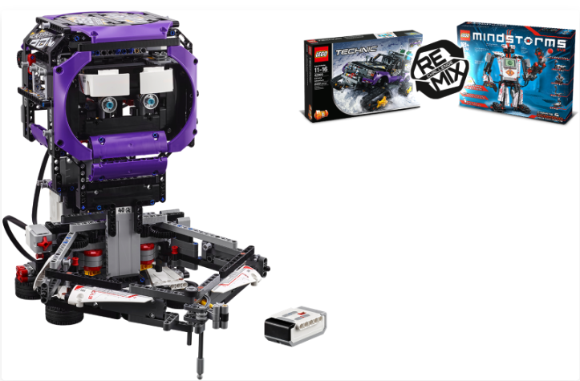

# Doodlebot (Robot Remix Doodle)

A LEGO Mindstorms EV3 robot that draws on paper with a pen. It can draw a face and simple shapes by itself, or be driven with the IR remote.

This is a Pybricks port of the original EV3-G (LabVIEW) programs in `Doodle_Robot.ev3`.

Author: Jim Bolanos

## Models

- LEGO Mindstorms EV3 (31313)
- LEGO Technic (42069)

Built as a "Robot Remix" of these two sets.

## Hardware

- Brick: EV3 (Pybricks firmware)
- Port A: medium motor (face and pen lift)
- Port B: large motor (arm 1)
- Port C: large motor (arm 2)
- Port S1: touch sensor (arm home position)
- Port S3: color sensor (head home position, detects red)
- Port S4: infrared sensor (IR remote control)

## Modes

Change `MODE` at the top of `main.py`:

| MODE | Behavior |
|------|----------|
| `1` | Move the pen with the IR remote |
| `2` | Move the pen with the IR remote, and lift/lower it and change the face with the beacon button |
| `3` | Draw a face by itself (default) |

## How it works

1. In modes 2 and 3 the head calibrates itself using the color sensor.
2. The arms calibrate themselves using the touch sensor.
3. Mode 3 draws a circle (face), two small rectangles (eyes) and a line (mouth), then stops.

## Code

- `main.py`: main program (inverse kinematics for the arms, pen control, drawing routines)
- `Doodle_Robot.ev3`: original EV3-G program, for reference
- `Doodle_Bot.pdf`: build instructions

## Build instructions

See [`Doodle_Bot.pdf`](Doodle_Bot.pdf).
